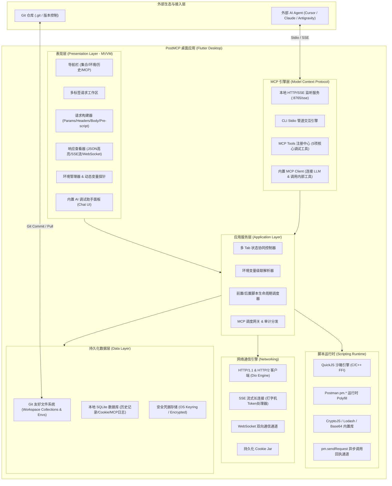
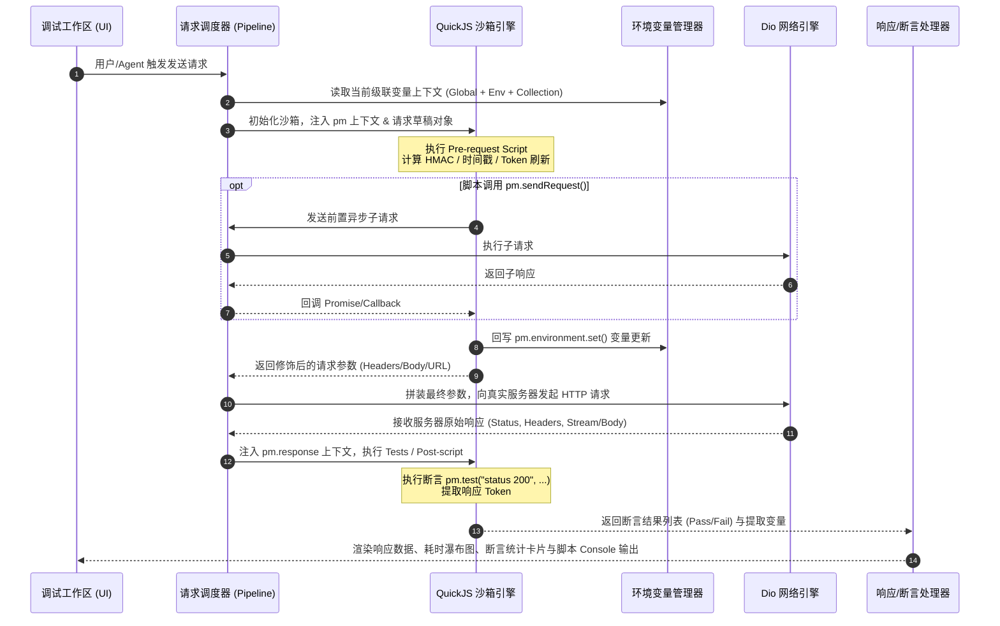
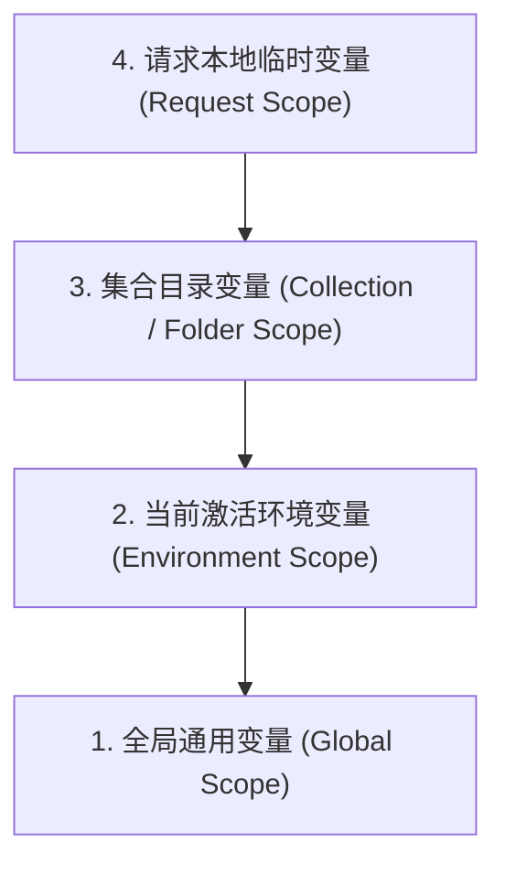
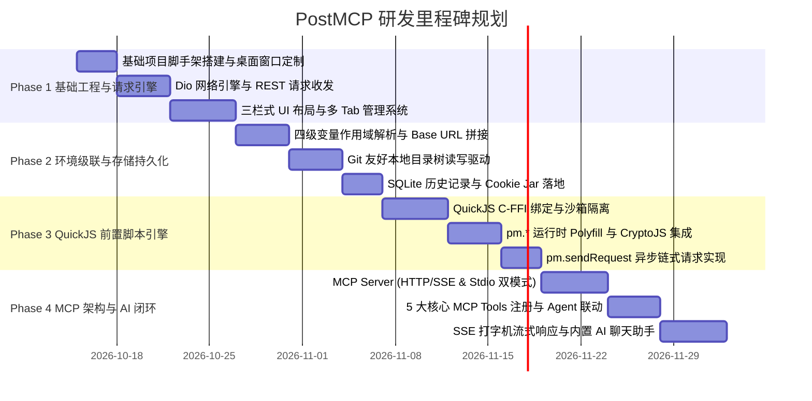

# PostMCP 系统架构与技术设计文档 (Software Design Document)

> **项目名称**：PostMCP (Next-Gen AI-Native API Workbench)  
> **技术栈**：Flutter (Windows / macOS / Linux) + Dart + QuickJS (FFI) + SQLite + MCP (Model Context Protocol)  
> **文档版本**：v1.0.0  
> **设计日期**：2026-10-12  

---

## 1. 概述与核心愿景

### 1.1 背景与痛点
传统 API 调试工具（如 Postman、Insomnia 等）在现代 AI 驱动与本地化协作的开发浪潮中面临诸多挑战：
1. **工具越来越臃肿与云端强制绑定**：强制要求注册云端账号、工作区云同步受限，企业敏感内网接口存在泄漏风险。
2. **缺乏原生 AI Agent 互操作协议（MCP）**：AI 编程助手（如 Cursor、Claude Desktop、自定义 Agent）无法直接、可靠地调度客户端内的 API 集合、环境变量与执行流进行端到端闭环调试。
3. **团队协作与 Git 脱节**：大部分工具采用中心化闭源存储，与开发团队的 Git 代码仓库割裂，分支合并与版本回溯成本高。
4. **复杂鉴权前置计算门槛高**：企业私有网关通常涉及复杂的 HMAC、RSA、时间戳与动态 Token 刷新，需要健壮、安全的前置脚本沙箱支持。

### 1.2 核心目标
打造一款**轻量、极速、Git 友好、具备 AI Agent 原生互操作协议（MCP）的高性能 Flutter 桌面 API 工作台**：
- **纯本地桌面原生**：运行于 Windows、macOS 与 Linux，无浏览器跨域限制，拥有原生网络引擎与毫秒级启动速度。
- **全功能 MCP 赋能**：对外作为标准 MCP Server（支持本地 HTTP/SSE 与 CLI Stdio 双模式），向外部 AI Agent（如 Cursor / Claude）暴露接口检索、调试执行与环境配置能力；对内集成 AI 助手（MCP Client），支持自然语言生成请求、断言与签名脚本。
- **沙箱化 QuickJS 前置/后置脚本**：深度兼容 Postman `pm.*` API（`pm.environment`、`pm.variables`、`pm.request`、异步 `pm.sendRequest`），预装 CryptoJS 加解密生态。
- **级联环境变量与 Base URL 矩阵**：四级作用域解析（全局 > 环境 > 集合 > 请求），支持隐式相对路径自动拼接与显式 `{{baseUrl}}` 占位符解析，敏感 Token 掩码脱敏。
- **混合持久化存储**：API 集合与环境以标准 JSON 文件保存在本地目录（天然适配 Git），历史记录、Cookie Jar 与 MCP 审计日志存储于本地 SQLite。

---

## 2. 系统总体架构

### 2.1 系统架构图



### 2.2 核心分层职责规范

| 架构层级 | 核心模块 | 主要职责 |
| :--- | :--- | :--- |
| **Presentation (UI)** | Views, ViewModels, Custom Widgets | 采用 MVVM 模式，负责现代化桌面布局渲染、代码高亮编辑器、响应数据格式化、SSE 打字机动画以及内置 AI 聊天组件。 |
| **Application** | EnvResolver, RequestExecutor, MCPSupervisor | 协调请求执行流水线：变量提取 -> 前置脚本执行 -> 请求修饰 -> 网络调用 -> 后置脚本/断言 -> 响应解析 -> 历史归档。 |
| **MCP Engine** | StdioRunner, SSEServer, ToolRegistry | 标准化暴露 MCP 协议服务；将内部 API 与环境操作抽象为原子化 Tools，实现外部 Agent 调度与内部 AI 对话驱动。 |
| **Script Engine** | QuickJS FFI Binding, Context Bridge | 提供独立无污染的 JS 隔离沙箱；注入 `pm.*` API 实例，拦截异步 `pm.sendRequest` 并安全回调。 |
| **Network Engine** | DioCore, StreamManager, CookieManager | 执行底层 Socket / TLS / HTTP 请求，无跨域限制捕获完整 Request/Response 原始流、DNS 与 Timing 耗时指标。 |
| **Data Layer** | WorkspaceRepo, HistoryRepo, CookieRepo | 双轨持久化：纯文本文件管理接口定义与环境配置；SQLite 管理运行态历史与日志。 |

---

## 3. 核心功能模块详细设计

### 3.1 模块一：MCP (Model Context Protocol) 核心架构与 Agent 调试系统

#### 3.1.1 协议角色与通信通道
PostMCP 具备**双角色融合架构**：
1. **外部 MCP Server（供第三方 Agent 调试）**：
   - **HTTP / SSE 通道**：桌面端后台常驻本地轻量 HTTP Server（默认 `http://127.0.0.1:8765/sse`），外部 IDE（Cursor、Claude Desktop）可通过 SSE 连接常驻客户端。GUI 界面提供一键复制配置 JSON 的能力。
   - **CLI Stdio 通道**：支持无头启动命令 `postmcp --mcp-stdio --workspace=/path/to/project`，供外部 Agent 作为原生 Subprocess 启动，零 GUI 资源消耗。
2. **内置 MCP Client（应用内 AI 交互）**：
   - 客户端界面右侧提供“AI 调试副驾（Copilot）”侧边栏，用户可配置 OpenAI / Claude / 本地 Ollama API Key。
   - 内置 AI 聊天助手直接作为 MCP Client 挂载当前应用的 MCP Tools，可通过自然语言自动执行：“*帮我测试登录接口，把生成的 token 设置到当前 Dev 环境变量中，然后再调用获取个人资料接口*”。

#### 3.1.2 暴露的 MCP Tools 规范设计
MCP 核心注册以下 5 个核心调试 Tools：

```json
[
  {
    "name": "list_collections_and_apis",
    "description": "列出当前工作区中所有 API 集合、目录树以及包含的请求简要信息（ID、名称、Method、URL）",
    "parameters": {
      "type": "object",
      "properties": {
        "collection_id": { "type": "string", "description": "可选：指定要查询的集合 ID，不传则列出所有集合" }
      }
    }
  },
  {
    "name": "get_api_detail",
    "description": "根据 API 请求 ID 获取完整的接口定义，包括 URL、方法、Headers、Query 参数、Body、前置脚本与后置断言",
    "parameters": {
      "type": "object",
      "properties": {
        "request_id": { "type": "string", "description": "请求的唯一标识符" }
      },
      "required": ["request_id"]
    }
  },
  {
    "name": "execute_api_request",
    "description": "调度应用引擎执行一个 API 请求。支持直接使用已存请求 ID 执行，或临时传入参数覆盖执行；将自动运行前置脚本、完成环境变量级联替换，并返回响应状态码、Headers、Body、耗时及后置断言结果",
    "parameters": {
      "type": "object",
      "properties": {
        "request_id": { "type": "string", "description": "已有请求 ID（可选）" },
        "method": { "type": "string", "enum": ["GET", "POST", "PUT", "DELETE", "PATCH"] },
        "url": { "type": "string", "description": "请求 URL，支持包含环境变量如 {{baseUrl}}/users" },
        "headers": { "type": "object", "description": "自定义 Headers 键值对" },
        "body": { "type": "string", "description": "请求体内容（JSON 字符串或 raw 格式）" },
        "environment_id": { "type": "string", "description": "执行所绑定的环境 ID，不传则使用当前激活环境" }
      }
    }
  },
  {
    "name": "manage_environment_variables",
    "description": "读取、切换环境，或动态修改特定环境下的变量值（如获取到 Token 后回填环境变量）",
    "parameters": {
      "type": "object",
      "properties": {
        "action": { "type": "string", "enum": ["get_all", "switch_active", "set_variable", "get_variable"] },
        "environment_id": { "type": "string", "description": "目标环境 ID" },
        "key": { "type": "string", "description": "变量名称（set_variable/get_variable 时必传）" },
        "value": { "type": "string", "description": "变量值（set_variable 时必传）" }
      },
      "required": ["action"]
    }
  },
  {
    "name": "get_execution_history_logs",
    "description": "查询最近发起的 API 调试记录与详细日志，包括控制台前置脚本打印（console.log）和完整错误栈",
    "parameters": {
      "type": "object",
      "properties": {
        "limit": { "type": "integer", "description": "拉取的日志条数，默认 10" }
      }
    }
  }
]
```

#### 3.1.3 安全与沙箱机制
- **本地回环绑定**：SSE 端口严格绑定在 `127.0.0.1`，拒绝任何局域网外部未授权访问。
- **动态 Token 握手机制**：首次启动或在设置面板中生成一次性 `MCP Authorization Bearer Token`，外部 Agent 握手时必须在请求头携带 `Authorization: Bearer <TOKEN>`。
- **调用审计日志**：界面“MCP 控制台”实时滚动外部 Agent 的调用时间、调用的 Tool 名称、传入参数及执行回执，支持一键断开会话。

---

### 3.2 模块二：前置脚本（Pre-request Script）与后置测试引擎

#### 3.2.1 脚本执行生命周期流水线



#### 3.2.2 QuickJS 沙箱与 `pm.*` API 设计
通过 C-FFI 绑定快速启动轻量 QuickJS Context，执行开销低于 2ms。在沙箱初始化时预注入以下对象：

1. **`pm.environment` & `pm.variables`**：
   - `pm.environment.get(key: string): any`
   - `pm.environment.set(key: string, value: any): void`
   - `pm.environment.unset(key: string): void`
   - `pm.variables.get(key: string): any`（按层级级联查找）
2. **`pm.request`（可读写当前请求模型）**：
   - `pm.request.url.addQueryParams({ key: "sign", value: signStr })`
   - `pm.request.headers.add({ key: "X-Signature", value: hmacVal })`
   - `pm.request.body.raw`（动态重写 Body 内容）
3. **`pm.sendRequest`（异步请求链）**：
   ```javascript
   // 支持在主请求前发送认证换票请求
   pm.sendRequest({
       url: pm.environment.get("authUrl") + "/oauth/token",
       method: "POST",
       header: { "Content-Type": "application/json" },
       body: JSON.stringify({ appId: "test", secret: pm.environment.get("appSecret") })
   }, function (err, res) {
       var data = res.json();
       pm.environment.set("accessToken", data.access_token);
   });
   ```
4. **预置第三方加解密库**：
   - 内置打包并随上下文自动加载：`CryptoJS`（MD5、SHA-1、SHA-256、SHA-512、HmacSHA256、AES、DES）、`jsencrypt`（RSA 非对称加密）、`lodash`（数据处理）、`Base64`、`moment`（日期格式化）。
5. **动态全局占位符（无需手写脚本即可在 URL/Body/Headers 中引用）**：
   - `{{$timestamp}}`：当前秒级时间戳
   - `{{$timestamp_ms}}`：当前毫秒级时间戳
   - `{{$uuid}}` / `{{$guid}}`：生成的 UUID v4
   - `{{$randomInt}}`：随机整数 (0~1000)

#### 3.2.3 异常防御与超时控制
- **执行超时中断**：使用 Dart `Isolate` + QuickJS Interrupt Handler，单次前置脚本执行时间严格限制在 5000ms 以内，死循环代码将强制终止并输出错误日志，避免阻塞桌面 UI 渲染。
- **环境隔离**：每次请求创建独立的 QuickJS 实例，脚本执行完成后立即释放，防止全局变量污染与内存泄漏。

---

### 3.3 模块三：环境变量与 Base URL 级联管理系统

#### 3.3.1 四级变量作用域层级
变量解析遵循**“由内向外、后者覆盖前者”**的标准级联模型：



- **Global 变量**：跨所有集合与环境可见（如常用测试手机号、公共加解密静态 Key）。
- **Environment 变量**：与具体环境绑定（Dev, Test, Pre, Prod），切换环境时整套动态替换。
- **Collection / Folder 变量**：挂载在特定集合或子目录下（如属于“订单系统集合”的统一微服务前缀）。
- **Request 变量**：当前请求独立的临时变量或前置脚本运行中计算的值。

#### 3.3.2 Base URL 与相对路径解析策略
支持两种开发者常用的使用习惯，实现零割裂体验：
1. **显式占位符解析**：
   - 用户在 URL 输入框键入：`{{baseUrl}}/api/v1/orders`。
   - 解析器扫描 `{{...}}` 正则，在当前级联变量表中提取 `baseUrl` 的值（如 `https://dev-api.example.com`）并直接替换。
2. **隐式自动补齐（Base URL Dedicated Field）**：
   - 每个环境模型中除自由键值列表外，包含一个第一公民属性：`baseUrl`（例如 `https://api.test.domain.com`）。
   - 当用户在 URL 输入框中直接输入相对路径（例如 `/api/v2/users` 或 `api/v2/users`）时，系统自动识别为相对路径，自动结合当前环境的 Base URL 进行规范化拼接：
     $$\text{Final URL} = \text{Environment.baseUrl.trimEnd('/')} + '/' + \text{InputPath.trimStart('/')}$$
3. **环境动态切换组件**：
   - 窗口右上角常驻环境切换下拉框（例如 `Dev [开发环境]`, `Test [测试环境]`, `Prod [生产环境]`, `No Environment`）。
   - 支持**快速悬停探针（Variable Hover Card）**：鼠标悬停在输入框中的 `{{xxx}}` 上时，弹出浮窗显示其当前激活环境中的实际值、所属作用域类型及是否为敏感密钥。
   - **Secret 掩码与脱敏**：敏感变量（如密码、Token、API Key）标记为 `Secret` 类型，UI 默认显示为 `••••••••`，提供小眼睛切换显示，且在导出为分享文件时可选择“排除敏感值”。

---

### 3.4 模块四：数据持久化与 Git 友好协同架构

#### 3.4.1 混合存储模型（Hybrid Persistence）
为兼顾**团队 Git 版本控制**与**桌面高频历史记录高性能查询**，系统采用双轨存储架构：

```
Local File System (Git-friendly Workspace)  ──> 集合定义、目录树、请求描述、环境配置
Local SQLite Engine (Cache & Runtime Data) ──> 请求日志历史、Cookie Jar、MCP 会话、UI 草稿态
```

#### 3.4.2 本地工作区目录结构规范
用户创建或打开的每一个工作区，在本地文件系统中均表现为一个整洁的目录树，所有文件采用标准化 JSON 结构落盘，任何 Git 客户端均可执行 `git diff` / `git commit`：

```text
my-api-workspace/
├── .postmcp/
│   ├── workspace.json                  # 工作区元信息（名称、版本、默认设置）
│   ├── globals.json                    # 全局变量列表
│   └── environments/                   # 环境配置目录
│       ├── development.env.json        # 开发环境配置（Base URL 与变量）
│       ├── testing.env.json            # 测试环境配置
│       └── production.env.json         # 生产环境配置（可配置 .gitignore 忽略）
├── collections/                        # 接口集合目录
│   ├── 用户认证中心/
│   │   ├── _collection.json            # 集合元信息、集合级变量与公共前置脚本
│   │   ├── 01_用户登录.req.json         # 单个请求详细配置
│   │   ├── 02_刷新Token.req.json
│   │   └── 会员管理/                   # 支持无限级文件夹嵌套
│   │       ├── _folder.json
│   │       └── 01_获取用户详情.req.json
│   └── 支付结算中心/
│       └── ...
└── .gitignore                          # 自动生成，默认忽略私密环境与本地缓存
```

#### 3.4.3 本地 SQLite 缓存数据库设计
使用 `sqflite_common_ffi`，本地生成 `runtime_cache.db`，表结构设计如下：

1. **`request_history`（执行历史表）**：
   - `id` (INTEGER PRIMARY KEY AUTOINCREMENT)
   - `request_id` (TEXT, 关联请求定义 ID，可为空)
   - `method` (TEXT)
   - `url` (TEXT)
   - `request_headers` (TEXT - JSON)
   - `request_body` (TEXT)
   - `response_status` (INTEGER)
   - `response_headers` (TEXT - JSON)
   - `response_body` (TEXT)
   - `duration_ms` (INTEGER)
   - `size_bytes` (INTEGER)
   - `script_logs` (TEXT - JSON 数组记录 console 输出)
   - `created_at` (INTEGER 时间戳)
2. **`cookie_jar`（Cookie 存储表）**：
   - `domain` (TEXT)
   - `path` (TEXT)
   - `name` (TEXT)
   - `value` (TEXT)
   - `expires_at` (INTEGER)
   - `is_secure` (INTEGER)
   - `is_http_only` (INTEGER)
   - `PRIMARY KEY (domain, path, name)`
3. **`mcp_audit_log`（MCP 调度审计表）**：
   - `id` (INTEGER PRIMARY KEY)
   - `client_info` (TEXT, 例如 Cursor / Claude / Internal Agent)
   - `tool_name` (TEXT)
   - `parameters` (TEXT - JSON)
   - `response_summary` (TEXT)
   - `created_at` (INTEGER)

---

### 3.5 模块五：网络通信与多协议调试引擎

#### 3.5.1 HTTP/1.1 & HTTP/2 核心客户端
- 基于 **Dio + 原生 HttpClient Adapter**，完美解开跨域桎梏，支持全格式请求体：
  - `none`：无 Body 请求
  - `form-data`：多表单文件上传，支持本地文件路径直接流式上传
  - `x-www-form-urlencoded`：标准表单编码
  - `raw`：JSON, XML, HTML, Plain Text, JavaScript（编辑器提供语法校验与格式化）
  - `binary`：二进制文件流
  - `GraphQL`：专属 Query / Mutation 编辑框与 Variables JSON 拆分输入

#### 3.5.2 SSE (Server-Sent Events) 打字机实时流式响应
现代开发中 AI 接口普遍使用 SSE（如 `/chat/completions` 流式打字机）：
- 客户端内置流式事件解析器，对 `text/event-stream` 进行行拆解（`data: {...}`、`event: ...`、`id: ...`）。
- **打字机动态渲染模式**：UI 实时以低延迟打字机形式逐 token 增量滚动展示文本，并在右侧侧边栏展示逐帧 Event 列表与时间戳。
- 支持一键将多帧流式事件拼接还原为完整的 Markdown / JSON 最终视图。

#### 3.5.3 WebSocket 双向交互调试
- 支持 `ws://` 与 `wss://` 连接建立，自定义握手 Headers。
- 交互式消息时间线：以气泡形式区分发送（Send）与接收（Receive）消息，支持 JSON 自动格式化。
- 支持自动化心跳配置（定时发送 Ping / 自定义心跳帧）。

---

## 4. UI/UX 桌面布局与交互设计

### 4.1 现代化三栏式工作台

```
+---------------------------------------------------------------------------------------------------------+
| [LOGO] PostMCP        [🔍 搜索接口/历史 Ctrl+P]             [环境: Dev (开发环境) ▾] [⚙️ 设置] [MCP 🟢 :8765] |
+-----------+-------------------------------------------------------------------------------+-------------+
| 侧边导航  | 多标签页: [GET /api/v1/users ✖] [POST /orders ✖] [+]                          | AI 调试助手 |
+-----------+-------------------------------------------------------------------------------+-------------+
| 📁 集合   | [GET ▾] [ https://dev-api.com/api/v1/users                      ] [ 发送 (Send) ] | 🤖 智能副驾 |
|  ▾ 用户中心|-------------------------------------------------------------------------------+             |
|   GET 登录| [Params (2)] [Headers (3)] [Body (JSON)] [Pre-script 🟢] [Tests] [Settings]   | "我想调试下 |
|   POST 注册|-------------------------------------------------------------------------------+ 创建用户接口|
|  ▾ 订单中心| Pre-request Script (QuickJS)                                                  | 参数需要带上|
|   POST 下单| 1 | // 动态生成 HMAC-SHA256 签名                                               | 动态签名..."|
|           | 2 | const timestamp = Date.now();                                                 |             |
| 🕒 历史   | 3 | const sign = CryptoJS.HmacSHA256(timestamp + "secret", "KEY").toString();    | [生成并填入]|
| 🌐 环境   | 4 | pm.request.headers.add({ key: "X-Sign", value: sign });                       |             |
| 🤖 MCP    |-------------------------------------------------------------------------------+-------------|
|           | Response: Status: 200 OK | Time: 48ms | Size: 1.2 KB [复制] [保存为示例]              | 外部 MCP 接入|
|           | [Body (Pretty JSON)] [Headers (8)] [Cookies] [Console Logs (1)] [Test Results]| 状态: 运行中|
|           | {                                                                             | 工具数: 5   |
|           |   "code": 200,                                                                | 监听端口:   |
|           |   "data": { "userId": 10086, "token": "ey..." }                               | 127.0.0.1:  |
|           | }                                                                             | 8765        |
+-----------+-------------------------------------------------------------------------------+-------------+
```

### 4.2 核心交互亮点
1. **多 Tab 管理与防丢草稿**：支持类似 VS Code 的多请求标签页拖拽排序、脏标记（未保存的小圆点提示），即使异常退出也能从本地 SQLite 草稿中无损恢复。
2. **专业级代码编辑器**：集成 `flutter_code_editor` / `re_editor`，支持 JSON 折叠、快捷键缩进、JavaScript 语法着色与行号高亮。
3. **控制台日志实时面板**：请求下方提供与 Chrome DevTools 类似的 Console 面板，显示脚本中的 `console.log()`、`console.warn()`、`console.error()` 与网络执行耗时分解（DNS Lookup -> TCP Handshake -> TLS Handshake -> TTFB -> Download）。

---

## 5. 技术选型与依赖清册

| 分类 | 选用技术/组件 | 版本建议 | 选型理由 |
| :--- | :--- | :--- | :--- |
| **基础框架** | **Flutter Desktop** (Dart 3.x) | 3.24+ | 具备 Dart 3 强模式、模式匹配，桌面渲染性能卓越，跨 Windows/macOS/Linux 统一体验。 |
| **状态管理** | **flutter_riverpod** | ^2.5.1 | 编译期安全、无上下文依赖、易于进行模块化依赖注入与单元测试。 |
| **HTTP 引擎** | **dio** + **dio_cookie_manager** | ^5.6.0 | 丰富的拦截器生态、原生支持流式取消（CancelToken）、流式下载与文件分块。 |
| **JS 沙箱引擎**| **quickjs_dart** (或 `flutter_js`) | 最新稳定版 | C 语言编写的高性能极轻量 JS 解释器，冷启耗时极低，支持 ES2020 语法，内存隔离性强。 |
| **代码编辑器** | **re_editor** | ^0.5.0 | 高性能桌面代码编辑器，支持大规模文本、多光标、括号高亮匹配与行折叠。 |
| **本地数据库** | **sqflite_common_ffi** + **sqlite3** | ^2.3.0 | 桌面端原生 SQLite FFI 驱动，读写速度极快，无需依赖移动端底层通道。 |
| **MCP 本地服务**| **shelf** + **shelf_router** + **shelf_web_socket** | ^1.4.0 | 官方 Dart 本地 HTTP 服务器套件，高并发处理 SSE 与 REST 接口调度。 |
| **加解密算法库**| **crypto** + **encrypt** | ^3.0.3 | 原生 Dart 提供基础 MD5/SHA/AES 支持，作为备用底层算法加速。 |
| **系统托盘/窗口**| **window_manager** | ^0.3.9 | 桌面窗口自由缩放、最小化到托盘、无边框沉浸式标题栏定制。 |

---

## 6. 项目工程目录组织

遵循 Clean Architecture + Feature-first 架构组织工程目录：

```text
e:/API/post/
├── android/                        # 移动端外壳（预留）
├── windows/                        # Windows 桌面入口配置
├── macos/                          # macOS 桌面入口配置
├── linux/                          # Linux 桌面入口配置
├── pubspec.yaml                    # 项目依赖声明
├── lib/
│   ├── main.dart                   # 桌面应用统一主入口
│   ├── main_mcp_cli.dart           # 无头 CLI Stdio MCP Server 独立入口
│   │
│   ├── core/                       # 核心基础设施与全局工具
│   │   ├── constants/              # 全局常量、默认配置
│   │   ├── theme/                  # 现代化明暗主题配置
│   │   ├── utils/                  # 字符串替换、占位符正则、时间工具
│   │   └── errors/                 # 全局异常与错误码定义
│   │
│   ├── data/                       # 数据访问与持久化驱动
│   │   ├── datasources/
│   │   │   ├── file_workspace_ds.dart   # 文件树读写与 JSON 序列化
│   │   │   ├── sqlite_history_ds.dart   # SQLite 历史记录 CRUD
│   │   │   └── secure_keyring_ds.dart   # 敏感凭据系统安全存储
│   │   ├── models/                 # 数据传输与持久化模型 (DTO)
│   │   └── repositories/           # 仓储模式实现
│   │
│   ├── domain/                     # 业务领域实体与用例 (Domain Logic)
│   │   ├── entities/               # 纯领域实体 (Request, Collection, Environment)
│   │   │   ├── api_request.dart
│   │   │   ├── environment.dart
│   │   │   └── variable_scope.dart
│   │   └── usecases/               # 核心业务执行器
│   │       ├── resolve_variables_usecase.dart # 环境变量级联解析
│   │       ├── execute_request_usecase.dart    # 串联脚本与请求流水线
│   │       └── export_collection_usecase.dart  # Postman/OpenAPI 导出
│   │
│   ├── engine/                     # 核心引擎层
│   │   ├── network/                # 网络通信引擎
│   │   │   ├── dio_client.dart
│   │   │   ├── sse_stream_handler.dart
│   │   │   └── websocket_client.dart
│   │   ├── script/                 # 脚本运行时引擎
│   │   │   ├── quickjs_sandbox.dart
│   │   │   ├── pm_context_bridge.dart
│   │   │   └── crypto_bundles.dart
│   │   └── mcp/                    # MCP 协议引擎
│   │       ├── mcp_server.dart     # HTTP/SSE & Stdio 调度核心
│   │       ├── mcp_tool_registry.dart # 5 大核心 Tools 实现
│   │       └── mcp_client.dart     # 应用内 AI 助手使用的客户端
│   │
│   └── presentation/               # 表现层 (UI & ViewModels)
│       ├── common_widgets/         # 按钮、下拉框、标签、语法树通用控件
│       └── features/
│           ├── workspace/          # 集合树与文件导航
│           ├── request_tab/        # 请求编辑工作台 (URL/Headers/Body)
│           ├── script_editor/      # 前置/后置脚本编辑与语法高亮
│           ├── response_viewer/    # 响应渲染 (JSON/SSE/Headers/Timing)
│           ├── environment_manage/ # 环境变量弹窗与悬停探针
│           ├── mcp_dashboard/      # MCP 运行监控与外部接入配置面板
│           └── ai_copilot/         # 内置 AI 助手聊天侧边栏
└── test/                           # 单元测试与用例集
```

---

## 7. 分阶段演进与里程碑计划



---

## 8. 总结

PostMCP 通过将 **Flutter 的桌面原生性能**、**QuickJS 的轻量脚本沙箱** 与 **新兴的 MCP AI 互操作协议** 相结合，打破了传统 API 工具要么过于臃肿依赖云端、要么无法与 AI Agent 顺畅协作的困局。本设计文档为后续各功能模块的编码实现提供了严密、系统、可落地的工程蓝图。
