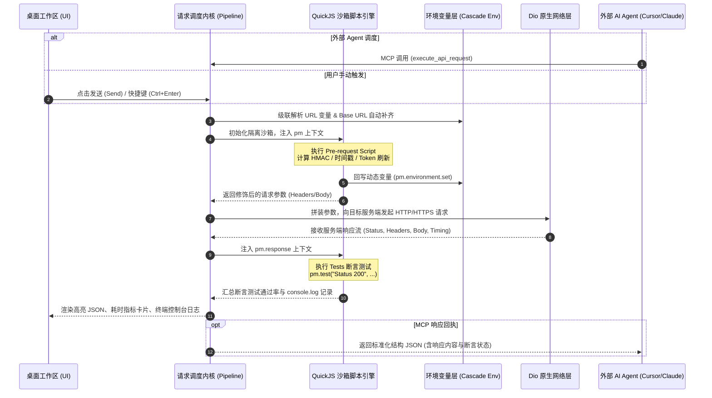

# MindPost - AI-Native API Workbench

<p align="center">
  
</p>

<p align="center">
  <strong>专为现代工程师与 AI Agent 协同打造的轻量、极速、安全、Git 友好型 API 桌面调试工作台</strong>
</p>

<p align="center">
  
  
  
  
  
  
</p>

---

## 🌟 核心愿景与特性

传统的 API 调试工具普遍面临**体积臃肿、强制绑定云端账号、企业内网数据泄露风险**，以及**无法与新兴 AI 编程助手（Cursor / Claude / 自定义 Agent）顺畅互操作**的痛点。

**MindPost** 基于 Flutter 原生桌面技术栈打造，打破云端黑盒绑架，在提供媲美桌面原生秒开体验的同时，深度拥抱 **Model Context Protocol (MCP)**，让 API 接口资产成为人类工程师与 AI Agent 共同调度的首要凭据。

### 🚀 1. 极致轻量 · 纯本地桌面原生
- **秒级冷启动**：无 Electron 冗余开销与浏览器跨域（CORS）枷锁，基于原生网络引擎与 Direct 硬件加速渲染。
- **数据隐私自主**：集合定义与环境变量以纯文本 JSON 格式规范落盘在本地目录中，天然适配 Git 分支管理与版本回溯。

### 🤖 2. 原生 MCP (Model Context Protocol) 赋能
- **双向 Agent 协同**：
  - **作为 MCP Server**：客户端内置本地 HTTP/SSE 协议网关（默认 `:8765/sse`），外部 AI 助手（如 Cursor、Claude Desktop、Antigravity）可直接连接并调用 5 大核心工具检索、读取与调度执行当前工作区中的真实接口；
  - **内置 AI 调试副驾 (Copilot)**：界面右侧集成 AI 对话侧边栏，支持自然语言一键生成请求参数、测试断言与加密签名脚本。

### ⚡ 3. 沙箱化 QuickJS 前置/后置脚本
- **无感沙箱隔离**：内置 QuickJS 引擎（C-FFI），单次执行开销低于 2ms，具备死循环中断与内存隔离保护。
- **深度兼容 Postman 生态**：支持 `pm.environment`、`pm.variables`、`pm.request`、异步 `pm.sendRequest` 链式调用。
- **开箱即用加解密**：内置 `CryptoJS`（MD5、SHA256、HmacSHA256、AES、DES）、`jsencrypt`（RSA）等，无需配置即可完成企业级动态签名与鉴权换票。

### 🌐 4. 四级变量级联与 Base URL 矩阵
- **智能作用域解析**：`全局 (Global) > 环境 (Environment) > 集合 (Collection) > 单请求 (Request)` 逐级继承与覆盖。
- **相对路径自动补全**：环境内置首要 `baseUrl` 属性，输入 `/api/v1/orders` 即可自动规范化拼接，亦兼容 `{{baseUrl}}` 显式占位符。
- **Token 掩码脱敏**：敏感变量（Password/Token/Secret）支持一键掩码，复制及导出时智能防泄露。

### 🎨 5. Modern Pro 工业级字体与代码排版 (方案 A)
- **精致 UI 呈现**：全局界面搭载 **Inter** 字体族，英文、标签与数字清晰现代，中文自动优雅回退至 `HarmonyOS Sans SC`、`PingFang SC` 与 `Microsoft YaHei`；
- **极客等宽体验**：JSON 响应树、代码编辑器、请求头表格及终端日志全面搭载 **JetBrains Mono** 字体族，字符辨识度高，支持操作符连字（Ligatures）；
- **高级响应查看**：内置语法分词高亮、响应耗时瀑布流分析、JSON 多级折叠以及数组对象一键转表格视图。

### 🔄 6. 多源兼容与 S3 私有云同步
- **一键平滑迁移**：内置导入解析器，完美兼容 Postman Collection v2.1、ApiPost 导出格式、Swagger / OpenAPI 3.0，以及浏览器（Chrome / Edge）的一键 `Copy as cURL (cmd / bash)`。
- **S3 兼容存储同步**：支持连接 MinIO、AWS S3、阿里云 OSS、Cloudflare R2，实现团队配置私有云加密快照备份与多端协同。

---

## 🏗️ 架构与请求生命周期



---

## 🚀 快速上手

### 环境准备
- [Flutter SDK](https://flutter.dev/docs/get-started/install) (>= 3.24.0, 推荐 3.27+)
- [Dart SDK](https://dart.dev/get-dart) (>= 3.5.0)
- **操作系统**：Windows 10/11 (x64), macOS (Apple Silicon / Intel), 或 Linux (x64)
- **C++ 编译工具链**：Windows 下需安装带 C++ CMake 桌面组件的 Visual Studio 2022

### 1. 克隆源码与拉取依赖
```bash
git clone http://tiechui.xyz:3000/zhangyi/MindPost.git
cd MindPost
flutter pub get
```

### 2. 本地调试运行（Windows 桌面）
> [!IMPORTANT]
> **请务必指定设备为 `windows`（原生桌面端）**。本项目的前置脚本引擎基于 QuickJS 底层 C 动态库（`dart:ffi`），无法在 Chrome 浏览器（Web 沙箱）中运行。

```powershell
flutter run -d windows
```

在 **VS Code** 或 **Android Studio / IntelliJ** 中运行时，请确认窗口底部/顶部的目标设备已切换为 **`Windows (windows-x64)`**。

### 3. 运行自动化测试
```powershell
flutter test
```

---

## 📦 打包与发布

### 构建 Windows 原生发布版
```powershell
flutter build windows --release
```
生成产物位于：`build\windows\x64\runner\Release\`。

### 生成 Inno Setup Windows 安装包
项目根目录已附带经过严格配置的 [installer.iss](file:///e:/API/post/installer.iss) 安装脚本，支持现代无边框向导、桌面快捷方式与优雅卸载：
```powershell
# 使用 Inno Setup 编译器命令行编译安装程序
ISCC.exe installer.iss
```
打包完成后将在 `dist/` 目录下生成 `MindPost-Setup-1.0.0.exe`。

---

## 🤖 Model Context Protocol (MCP) 配置指南

MindPost 启动后将在本地自动开启标准 MCP 监听服务（默认地址：`http://127.0.0.1:8765/sse`）。

### 接入 Cursor / Claude Desktop / Antigravity
在您的 AI 编程工具中配置 MCP Server：

```json
{
  "mcpServers": {
    "mindpost": {
      "url": "http://127.0.0.1:8765/sse",
      "transport": "sse"
    }
  }
}
```

### 内置 5 大 MCP 核心工具清册

| 工具名称 | 描述说明 | 典型场景 |
| :--- | :--- | :--- |
| `list_collections_and_apis` | 遍历并检索当前工作区中的集合、目录树及请求摘要 | 让 Agent 了解工作区有哪些接口资产 |
| `get_api_detail` | 获取指定请求的完整参数、Header、Body、前置脚本及断言 | Agent 分析接口入参与契约定义 |
| `execute_api_request` | 触发执行指定 API 请求（支持前置脚本与环境变量自动计算） | Agent 执行接口自测、闭环调优与验证 |
| `manage_environment_variables` | 检索、切换当前环境，或写入/更新特定环境变量 | 登录后提取 Token 自动回填至测试环境 |
| `get_execution_history_logs` | 获取最近的请求执行日志、网络耗时及脚本控制台输出 | Agent 诊断接口报错与断言失败原因 |

---

## ⌨️ 常用快捷键

| 快捷键 (Windows/Linux) | 快捷键 (macOS) | 功能说明 |
| :--- | :--- | :--- |
| `Ctrl + Enter` | `Cmd + Enter` | **发送当前请求**（Send Request） |
| `Ctrl + S` | `Cmd + S` | **保存当前修改**至本地工作区 |
| `Ctrl + T` | `Cmd + T` | **新建空白请求 Tab** |
| `Ctrl + W` | `Cmd + W` | **关闭当前激活 Tab** |
| `Ctrl + P` | `Cmd + P` | **全工作区快速接口检索**（Quick Open） |
| `Ctrl + E` | `Cmd + E` | **打开环境变量管理器** |
| `Ctrl + Shift + F` | `Cmd + Shift + F` | 格式化当前 JSON 请求体 |

---

## 📁 目录结构

```text
lib/
├── engine/                      # 核心执行引擎
│   ├── script_engine.dart       # QuickJS 沙箱驱动 & Postman pm.* Polyfill
│   └── variable_resolver.dart   # 级联变量解析器 & 占位符匹配引擎
├── models/                      # 核心领域实体与数据模型
│   ├── api_collection.dart      # 集合模型
│   ├── api_folder.dart          # 目录层级
│   ├── api_request.dart         # 请求契约（Params/Headers/Body/Scripts）
│   ├── api_response.dart        # 响应体（Status/Latency/Size/Logs）
│   ├── environment.dart         # 环境变量与 Base URL 实体
│   ├── s3_sync_config.dart      # S3 兼容私有云备份配置
│   └── workspace.dart           # 本地工作区实体
├── services/                    # 系统服务与外部交互
│   ├── apipost_migration_service.dart # Postman/ApiPost/OpenAPI 导入解析器
│   ├── http_client_service.dart # Dio 网络底层封装
│   ├── mcp_server_service.dart  # 本地 MCP HTTP/SSE 协议服务
│   ├── s3_sync_service.dart     # S3 云端加密同步服务
│   └── storage_service.dart     # 本地文件与持久化存储服务
├── ui/                          # 表现层与交互界面
│   ├── app_fonts.dart           # Modern Pro 统一字体栈体系 (Inter + JetBrains Mono)
│   ├── home_screen.dart         # 桌面端主工作台视窗
│   └── widgets/                 # 高度解耦的业务组件库
│       ├── ai_copilot_drawer.dart      # 内置 AI 副驾聊天抽屉
│       ├── api_tree_view.dart          # 侧边栏接口集合树形视图
│       ├── browser_import_dialog.dart  # 浏览器 cURL 解析导入对话框
│       ├── environment_dialog.dart     # 环境变量管理与切换弹窗
│       ├── json_syntax_highlighter.dart # JetBrains Mono 驱动的 JSON 语法高亮器
│       ├── key_value_editor.dart       # 现代化键值对编辑器
│       └── mcp_panel.dart              # MCP 状态面板与调用审计追踪
└── main.dart                    # 应用程序统一主入口
```

---

## 📄 开源许可

本项目采用 [MIT License](LICENSE) 授权许可。
欢迎提交 Issue 与 Pull Request 共同打造更好的下一代 AI 原生开发者工作台！
